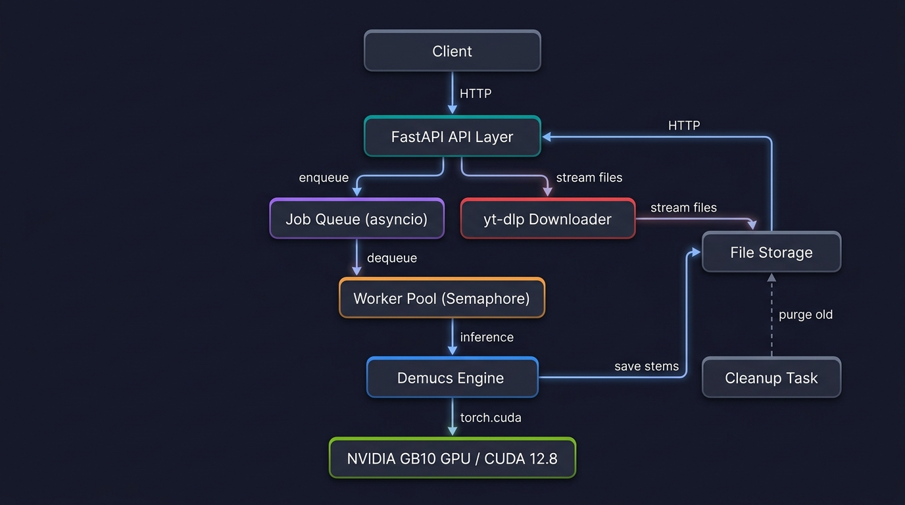
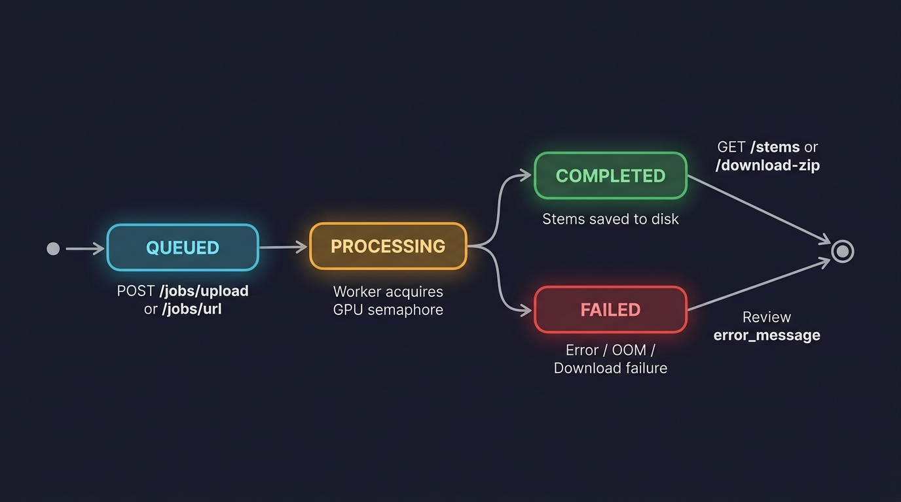
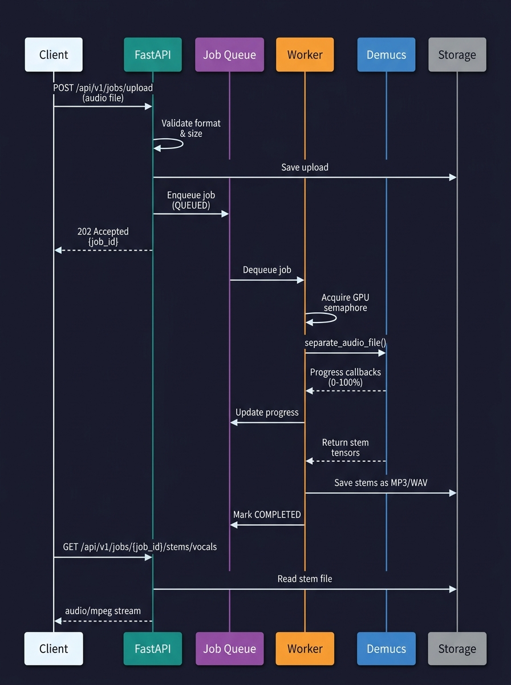

<div align="center">

# 🎵 Demucster

**GPU-accelerated audio stem separation microservice**

*Upload a song. Get back vocals, drums, bass, guitar, piano, and more — powered by Demucs on NVIDIA Blackwell.*

[](https://python.org)
[](https://fastapi.tiangolo.com)
[](https://pytorch.org)
[](https://developer.nvidia.com/cuda-toolkit)
[](LICENSE)

</div>

---

## Overview

Demucster is an asynchronous, containerised microservice that performs **audio stem separation** using Facebook's [Demucs](https://github.com/facebookresearch/demucs) models — specifically designed and tuned for the **NVIDIA DGX Spark** (GB10 Blackwell, 128 GB unified memory).

Upload an audio file (or paste a YouTube / SoundCloud URL), and Demucster will return each stem — vocals, drums, bass, other, piano, guitar — as a separate high-quality audio file.

### Key Features

- 🚀 **GPU-accelerated** — CUDA inference with real-time progress tracking
- 📁 **Multi-format input** — MP3, WAV, FLAC, OGG, M4A
- 🌐 **URL ingestion** — YouTube, SoundCloud, and more via yt-dlp
- 🎛️ **6 Demucs models** — from `htdemucs_ft` (highest quality) to `mdx` (fastest)
- 📦 **Stem downloads** — individual stems or all-in-one ZIP
- 🔄 **Async job queue** — bounded GPU concurrency prevents OOM
- 🧹 **Auto-cleanup** — files purged after configurable retention window
- 🐳 **Docker-ready** — single `docker compose up` with NVIDIA GPU support

---

## Architecture

<div align="center">
  
</div>

<br/>

## Job Lifecycle

<div align="center">
  
</div>

<br/>

## Request Flow

<div align="center">
  
</div>

---

## Quick Start

### Prerequisites

| Requirement | Version |
|---|---|
| Python | ≥ 3.11 |
| CUDA Toolkit | ≥ 12.8 |
| NVIDIA Driver | ≥ R570 |
| ffmpeg | Any recent |
| uv | Latest |
| Docker + NVIDIA Container Toolkit | For containerised deployment |

### Local Development

```bash
# Clone and enter
git clone <repo-url> demucster && cd demucster

# Install dependencies with uv (resolves PyTorch from CUDA 12.8 index)
uv sync

# Copy and customise environment
cp .env.example .env

# Run the dev server
uv run uvicorn demucster.main:app --reload --host 0.0.0.0 --port 8000
```

### Docker Deployment (Recommended)

```bash
# Run this natively on the ARM64 DGX Spark
docker compose up --build

# Verify readiness (must report healthy + cuda_available=true)
curl http://localhost:8000/api/v1/health | jq .

# Submit a real smoke-test track
curl -X POST http://localhost:8000/api/v1/jobs/upload \
  -F "file=@smoke-test.wav" \
  -F "model=htdemucs"
```

The Compose file pins an ARM64 NGC image, requires CUDA at startup, persists model
weights, and runs exactly one Uvicorn process. Do not increase Uvicorn's worker count:
the queue and job registry are intentionally in-process.

---

## API Reference

### Jobs

| Method | Endpoint | Description |
|---|---|---|
| `POST` | `/api/v1/jobs/upload` | Upload audio file + separation options |
| `POST` | `/api/v1/jobs/url` | Submit URL for download + separation |
| `GET` | `/api/v1/jobs` | List all jobs (filter by status, paginate) |
| `GET` | `/api/v1/jobs/{job_id}` | Get job status, progress, and metadata |
| `GET` | `/api/v1/jobs/{job_id}/stems/{stem_name}` | Download individual stem |
| `GET` | `/api/v1/jobs/{job_id}/source` | Download the retained full source mix |
| `GET` | `/api/v1/jobs/{job_id}/download-zip` | Download all stems as ZIP |
| `DELETE` | `/api/v1/jobs/{job_id}` | Delete job and its files |

### System

| Method | Endpoint | Description |
|---|---|---|
| `GET` | `/api/v1/health` | GPU status, VRAM, active/queued jobs |
| `GET` | `/api/v1/models` | List supported Demucs models |

### Example: Upload

```bash
curl -X POST http://localhost:8000/api/v1/jobs/upload \
  -F "file=@song.mp3" \
  -F "model=htdemucs_ft" \
  -F "output_format=mp3" \
  -F "mp3_bitrate=320"
```

### Example: URL Submission

```bash
curl -X POST http://localhost:8000/api/v1/jobs/url \
  -H "Content-Type: application/json" \
  -d '{
    "url": "https://www.youtube.com/watch?v=dQw4w9WgXcQ",
    "options": {
      "model": "htdemucs_ft",
      "output_format": "mp3"
    }
  }'
```

### Example: Download Stems

```bash
# Individual stem
curl -o vocals.mp3 http://localhost:8000/api/v1/jobs/{job_id}/stems/vocals

# All stems as ZIP
curl -o stems.zip http://localhost:8000/api/v1/jobs/{job_id}/download-zip
```

---

## Supported Models

| Model | Stems | Quality | Speed | Description |
|---|---|---|---|---|
| **`htdemucs_ft`** ⭐ | 4 | ★★★★★ | ★★★ | Fine-tuned Hybrid Transformer — **best quality** |
| `htdemucs` | 4 | ★★★★ | ★★★★ | Hybrid Transformer — great balance |
| `htdemucs_6s` | 6 | ★★★★ | ★★★ | Adds **guitar** + **piano** stems |
| `mdx_extra` | 4 | ★★★★ | ★★★★ | MDX-Net — strong alternative |
| `mdx_extra_q` | 4 | ★★★ | ★★★★★ | Quantised MDX — fastest |
| `mdx` | 4 | ★★★ | ★★★★★ | MDX baseline |

Default: `htdemucs_ft`. Set via `DEFAULT_MODEL` env var or per-job `model` parameter.

---

## Configuration

All values are configurable via environment variables or a `.env` file.

| Variable | Default | Description |
|---|---|---|
| `DEFAULT_MODEL` | `htdemucs_ft` | Default Demucs model |
| `OUTPUT_FORMAT` | `mp3` | Stem output format (`mp3` / `wav`) |
| `MP3_BITRATE` | `320` | MP3 encoding bitrate (kbps) |
| `MAX_CONCURRENT_JOBS` | `2` | Max simultaneous GPU jobs |
| `DEVICE` | `cuda` | PyTorch device (`cpu`, `cuda`, or `cuda:<index>`) |
| `REQUIRE_CUDA` | `false` (`true` in Docker) | Fail startup if requested CUDA is unavailable |
| `SEGMENT_SIZE` | unset | Positive integer Demucs segment length in seconds |
| `UPLOAD_DIR` | `/data/uploads` | Upload storage path |
| `OUTPUT_DIR` | `/data/outputs` | Stem output path |
| `MAX_FILE_SIZE_MB` | `500` | Max upload size |
| `RETENTION_HOURS` | `24` | Hours before auto-purge |
| `PREWARM_MODEL` | `true` | Load default model on startup |
| `LOG_LEVEL` | `INFO` | Logging verbosity |
| `MAX_DOWNLOAD_DURATION` | `3600` | Max yt-dlp download (seconds) |

---

## DGX Spark / GB10 Blackwell Notes

This service is purpose-built for the **NVIDIA DGX Spark** with its **GB10 Grace Blackwell** superchip.

### What's Different

| Aspect | Standard GPU | DGX Spark (GB10) |
|---|---|---|
| **Memory** | Discrete VRAM (8–80 GB) | 128 GB unified LPDDR5x |
| **CPU↔GPU Transfer** | PCIe bottleneck | 900 GB/s coherent C2C |
| **Compute Capability** | Various | **12.1** (`sm_121`) |
| **PyTorch** | Any CUDA build | **≥ 2.7 + CUDA 12.8** required |
| **NVML** | Accurate | May misreport — use `torch.cuda` |

### What We Do

1. **`PYTORCH_CUDA_ALLOC_CONF=expandable_segments:True`** — prevents fragmentation OOM on the large unified pool.
2. **No `CUDA_MANAGED_FORCE_DEVICE_ALLOC`** — the coherent driver handles memory residency optimally when left alone.
3. **`torch.cuda` introspection** — health endpoint uses PyTorch APIs, not `pynvml`/`nvidia-smi`, to avoid NVML misreporting.
4. **Pinned NGC base image** (`nvcr.io/nvidia/pytorch:26.07-py3`) — provides the
   NVIDIA-tested ARM64 CUDA/PyTorch stack; container installation verifies it is not replaced.
5. **Verify kernel in DGX OS**: ensure `init_on_alloc=0` is set (default on DGX OS) to avoid allocation latency.

### Native acceptance check

Before exposing the service, verify all of the following on the DGX Spark:

1. `docker compose build` succeeds without compiling or replacing PyTorch.
2. `/api/v1/health` reports compute capability `12.1`, `healthy`, and CUDA available.
3. A real WAV job reaches `COMPLETED`; each individual stem and the ZIP download work.
4. `docker compose restart` shuts down cleanly after current queued work drains.
5. Recreating the container does not re-download model weights from the persistent cache.

---

## Project Structure

```
demucster/
├── src/demucster/
│   ├── main.py              # FastAPI app + lifespan
│   ├── api/
│   │   ├── router.py        # Route aggregation
│   │   ├── jobs.py          # Job CRUD endpoints
│   │   └── health.py        # Health + model listing
│   ├── core/
│   │   ├── config.py        # Pydantic Settings
│   │   ├── gpu.py           # CUDA/GB10 introspection
│   │   └── logging.py       # Structured JSON logging
│   ├── models/
│   │   └── schemas.py       # Pydantic v2 schemas
│   ├── services/
│   │   ├── separator.py     # Demucs inference wrapper
│   │   ├── audio.py         # Format validation + encoding
│   │   ├── downloader.py    # yt-dlp URL fetcher
│   │   └── cleanup.py       # Retention purge
│   └── worker/
│       └── queue.py         # Async job queue
├── tests/                   # pytest suite
├── Dockerfile               # NGC-based container
├── docker-compose.yml       # GPU-enabled compose
├── pyproject.toml           # uv + ruff + hatch config
└── .env.example             # Configuration template
```

---

## Development

### Running Tests

```bash
# All tests (no GPU required — Demucs is mocked)
uv run pytest tests/ -v

# With coverage
uv run pytest tests/ --cov=demucster --cov-report=term-missing
```

### Linting

```bash
# Check
uv run ruff check src/ tests/

# Auto-fix
uv run ruff check --fix src/ tests/

# Format
uv run ruff format src/ tests/
```

### Interactive API Docs

Once the server is running:
- **Swagger UI**: http://localhost:8000/docs
- **ReDoc**: http://localhost:8000/redoc

---

## License

MIT
